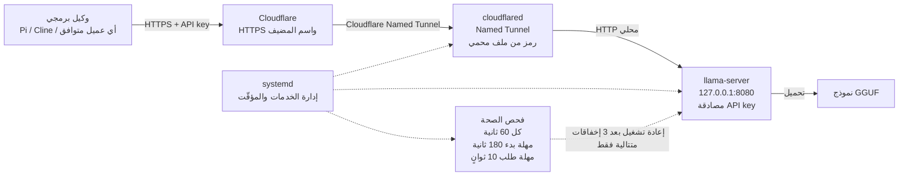

# تشغيل نموذج GGUF وربطه بوكلاء برمجة عبر Cloudflare Tunnel

يشرح هذا الدليل طريقة تشغيل **أي نموذج GGUF متوافق مع `llama.cpp`** على خادم Linux وإتاحة واجهة OpenAI-compatible عبر **Cloudflare Named Tunnel**، ثم توصيل وكلاء البرمجة المتوافقين بها. يمكن ربط أي عميل يقبل OpenAI-compatible Chat Completions وعنوان API مخصص؛ **Pi Coding Agent** على Termux و**Cline** مثالان، وليسا الخيارين الوحيدين. لا يعتمد الشرح على نموذج محدد.

> **مهم:** النفق لا يمنع الجهاز أو مزوّد الاستضافة من السكون أو التوقف. إذا توقف المضيف أو انقطع الإنترنت أو أوقفت بيئة الاستضافة، فلن يكون النموذج متاحًا. هذا إعداد تعلّمي/شخصي، وليس ضمانًا لتوفّر دائم أو بديلًا عن استضافة ومراقبة إنتاجية.

## ما الذي ستحتاجه؟

- جهاز Linux يعمل عليه `systemd` ويستطيع تشغيل النموذج المختار.
- نسخة من `llama.cpp` تتضمن `llama-server`، وملف GGUF متوافق.
- نطاق وCloudflare Named Tunnel مُعدّان في حسابك.
- عميل برمجي يقبل OpenAI-compatible endpoint؛ أمثلة الدليل: Pi على Termux أو Cline.

راجع [دليل llama.cpp HTTP Server](https://github.com/ggml-org/llama.cpp/tree/master/tools/server) و[توثيق Pi على Termux](https://pi.dev/docs/latest/termux) و[توثيق Cline لـOpenAI-compatible](https://docs.cline.bot/provider-config/openai-compatible) و[بدء إعداد Cloudflare Tunnel](https://developers.cloudflare.com/tunnel/get-started/) قبل التطبيق. قد تختلف أسماء الخيارات قليلًا بين الإصدارات؛ افحص `llama-server --help` و`cloudflared tunnel run --help` على جهازك.

## كيف تتصل الأجزاء؟

1. يشغّل `llama-server` ملف GGUF ويستمع على `127.0.0.1:8080` فقط.
2. يحمي الخادم واجهة API بمفتاح محفوظ في ملف محلي محمي.
3. يمرّر Cloudflare Tunnel الطلبات من اسم المضيف الذي تختاره إلى الخدمة المحلية.
4. يرسل أي عميل متوافق الطلبات إلى `https://<YOUR_HOSTNAME>/v1` مستخدمًا مفتاح API ومعرّف النموذج الذي يعلنه الخادم.
5. تُشغّل `systemd` الخدمات وتراقب صحة النموذج؛ يمكن ضبط فحص دوري بصلاحية محدودة لإعادة تشغيل خدمة النموذج فقط.

### مخطط الاتصال

يعرض المخطط مسار الطلب والإشراف على الخدمات؛ تعود الاستجابة إلى العميل عبر المسار نفسه:



## العملاء المتوافقون

إذا كان الوكيل يسمح بتحديد مزوّد **OpenAI Compatible** أو ما يعادله، فعادةً يحتاج إلى ثلاثة إعدادات: Base URL المنتهي بـ`/v1`، ومفتاح API، ومعرّف النموذج كما يظهر في `/v1/models`. قد تختلف أسماء الحقول بين البرامج، وقد تتطلب ميزات الوكيل (مثل استدعاء الأدوات أو الصور) توافقًا إضافيًا في العميل والخادم وقالب النموذج. راجع توثيق العميل واختبر طلبًا بسيطًا قبل الاعتماد عليه.

## 1. جهّز النموذج و`llama.cpp`

نزّل نموذج GGUF من مصدر تثق به، وتحقق من الترخيص ومتطلبات استخدامه. تأكد أن حساب الخدمة الذي سيشغّل `llama-server` يستطيع قراءة ملف النموذج وكل مجلداته الأب.

في الأمثلة التالية، استبدل `<MODEL_PATH>` بالمسار المطلق لملف GGUF. مثال تشغيل أولي، قبل إعداد `systemd`:

```bash
llama-server \
  --model <MODEL_PATH> \
  --host 127.0.0.1 \
  --port 8080 \
  --api-key-file /etc/llama.cpp/api-keys.txt \
  --jinja
```

`--host 127.0.0.1` مهم: لا تفتح منفذ النموذج مباشرةً على الإنترنت؛ دع النفق المحلي يصل إليه. خيار `--api-key-file` يقرأ مفتاحًا واحدًا أو أكثر، مفتاحًا في كل سطر. السطور الفارغة والأسطر التي تبدأ بـ`#` تُعامل كتعليقات بحسب توثيق الخادم. يُرسل العميل المفتاح بصيغة `Authorization: Bearer ...`.

### اختيار النموذج والسياق

صيغة GGUF وحدها لا تضمن أن كل نموذج يعمل على كل جهاز. يعتمد حجم النموذج والتكميم وسرعة التشغيل والسياق الممكن على RAM/VRAM والمعالج والبطاقة الرسومية وإعدادات `llama.cpp`. ابدأ بسياق محافظ، ثم اضبط `--ctx-size` إذا احتجت؛ زيادة السياق تستهلك ذاكرة إضافية، ويجب ألا تتجاوز ما يستطيع النموذج والخادم تحمّلهما.

عند استخدام وكيل برمجي يحتاج إلى استدعاء الأدوات، يجب أن يدعم النموذج وقالب المحادثة هذه الميزة. `--jinja` يفعّل دعم القوالب، لكنه لا يجعل كل نموذج أو قالب مثاليًا للأدوات؛ اختبر استدعاء أداة قراءة بسيطة قبل الاعتماد عليه. راجع [توثيق استدعاء الأدوات في llama.cpp](https://github.com/ggml-org/llama.cpp/blob/master/docs/function-calling.md) والقالب المرتبط بالنموذج.

## 2. خزّن مفتاح API في ملف محمي

لا تكتب المفتاح مباشرةً في `ExecStart` أو `models.json` أو سجل Git أو سجل أوامر shell. على خادم Linux، أنشئ حسابًا محدودًا للخدمة إن لم يكن لديك حساب مخصص بالفعل:

```bash
sudo useradd --system --home-dir /var/lib/llama --create-home \
  --shell /usr/sbin/nologin llama
```

أنشئ ملفًا يستطيع حساب `llama` قراءته دون بقية المستخدمين. المثال التالي يولّد مفتاحًا عشوائيًا مباشرةً إلى الملف ولا يطبعه في الطرفية؛ يتطلب `openssl`:

```bash
sudo install -d -o root -g llama -m 0750 /etc/llama.cpp
sudo sh -c 'umask 027; openssl rand -hex 32 > /etc/llama.cpp/api-keys.txt'
sudo chown root:llama /etc/llama.cpp/api-keys.txt
sudo chmod 0640 /etc/llama.cpp/api-keys.txt
```

زوّد كل عميل بالمفتاح عبر قناة أو إدخال خاص موثوق، ولا تضع نسخة منه في المستودع. إذا كان لديك مفتاح مُعدّ مسبقًا، ضعه في الملف نفسه بدل توليد مفتاح جديد، مع إبقاء السطر الذي يحتويه سرّيًا.

مثال تخزينه في ملف خاص على Termux لاستخدامه مع Pi أو مع اختبار الاتصال أدناه:

```bash
mkdir -p -m 700 "$HOME/.config/pi"
(umask 077; : > "$HOME/.config/pi/llama-api-key")
nano "$HOME/.config/pi/llama-api-key"
chmod 600 "$HOME/.config/pi/llama-api-key"
```

اكتب في الملف المفتاح نفسه الموجود في ملف الخادم واحفظه. لا تمرّره كجزء من أمر shell أو عنوان URL. إذا كان `nano` غير مثبت، استخدم محررًا محليًا موثوقًا. إذا كنت تستخدم Cline أو عميلًا آخر على جهاز مختلف، فلا تحتاج إلى إعداد ملف Termux؛ أدخل المفتاح في حقل السر المخصص داخل ذلك العميل.

## 3. شغّل `llama-server` عبر systemd

تحقق من مسار الملف التنفيذي باستخدام `command -v llama-server`، ثم احفظ الوحدة التالية في `/etc/systemd/system/llama-server.service`. استبدل `<MODEL_PATH>` بالمسار الحقيقي، وعدّل مسار البرنامج إذا لزم. يجب أن يستطيع المستخدم `llama` قراءة النموذج.

```ini
[Unit]
Description=llama.cpp model server
After=network.target

[Service]
Type=simple
User=llama
Group=llama
ExecStart=/usr/local/bin/llama-server --model <MODEL_PATH> --host 127.0.0.1 --port 8080 --api-key-file /etc/llama.cpp/api-keys.txt --jinja
Restart=on-failure
RestartSec=5s
NoNewPrivileges=true
PrivateTmp=true

[Install]
WantedBy=multi-user.target
```

ابدأ الخدمة وتحقق من جاهزيتها محليًا:

```bash
sudo systemctl daemon-reload
sudo systemctl enable --now llama-server.service
sudo systemctl status llama-server.service
curl --fail --silent --show-error --max-time 10 \
  http://127.0.0.1:8080/health >/dev/null && echo "النموذج جاهز"
```

يرجع `/health` الحالة `200` عند الجاهزية و`503` أثناء تحميل النموذج، وهو endpoint عام لا يتطلب مفتاح API. لا يعرض محتوى النموذج، لكنه يكشف حالة الجاهزية؛ ضع الخدمة خلف Cloudflare Access أو طبقة وصول مناسبة إذا أردت الحد من ذلك.

## 4. أعد Cloudflare Named Tunnel باستخدام ملف رمز

أنشئ **Remotely-managed Named Tunnel** من لوحة Cloudflare، وأضف Public Hostname يوجّه إلى `http://127.0.0.1:8080`. اجعل اسم المضيف خاصًا بك، مثل `https://<YOUR_HOSTNAME>`؛ لا تستخدم نطاقًا أو معرّفًا من إعداد شخص آخر.

من لوحة Cloudflare، افتح **Networking → Tunnels**، واختر النفق، ثم **Add a replica**. انسخ أمر التثبيت إلى محرر محلي (ولا تشغّله): قيمة الرمز هي الجزء السري الذي يبدأ عادةً بـ`eyJ`. من يملك هذا الرمز يستطيع تشغيل النفق؛ لا تنشره أو ترسله في مستودع. راجع [مرجع رموز Cloudflare Tunnel](https://developers.cloudflare.com/tunnel/reference/tunnel-tokens/).

استخدم إصدارًا حديثًا من `cloudflared` يدعم `--token-file`، وتأكد من ظهوره في `cloudflared tunnel run --help`. تذكر Cloudflare استخدام هذا الخيار في [مصدر تثبيت خدمة Linux](https://github.com/cloudflare/cloudflared/blob/master/cmd/cloudflared/linux_service.go)، كما تسجل [ملاحظات إصدارات cloudflared](https://github.com/cloudflare/cloudflared/blob/master/RELEASE_NOTES) تحديث خدمة Linux لاستخدامه. لا تضع الرمز ضمن سطر `ExecStart`.

أنشئ حساب خدمة ومجلدًا محميًا إن لم يكنا موجودين:

```bash
sudo useradd --system --no-create-home --shell /usr/sbin/nologin cloudflared
sudo install -d -o root -g cloudflared -m 0750 /etc/cloudflared
sudo install -o root -g cloudflared -m 0640 /dev/null /etc/cloudflared/tunnel-token
sudoedit /etc/cloudflared/tunnel-token
```

الصق **الرمز وحده** في الملف واحفظه، ثم تحقق من أن الملف مملوك لـ`root:cloudflared` وصلاحيته `0640`، وأن المجلد `0750`. لا تستخدم `--token <VALUE>` في خدمة systemd؛ قد يظهر السر في تفاصيل العملية أو إعداداتها.

احفظ الوحدة التالية باسم `/etc/systemd/system/cloudflared.service`. تحقق من مسار `cloudflared` بواسطة `command -v cloudflared` وعدّله عند الحاجة:

```ini
[Unit]
Description=Cloudflare Named Tunnel
Wants=network-online.target
After=network-online.target

[Service]
Type=notify
User=cloudflared
Group=cloudflared
ExecStart=/usr/bin/cloudflared tunnel --no-autoupdate run --token-file /etc/cloudflared/tunnel-token
Restart=on-failure
RestartSec=5s
NoNewPrivileges=true
PrivateTmp=true
ProtectHome=true
ProtectSystem=strict

[Install]
WantedBy=multi-user.target
```

في لوحة النفق، تأكد أن خدمة الوجهة هي `http://127.0.0.1:8080`، ثم شغّلها وتحقق من الحالة:

```bash
sudo systemctl daemon-reload
sudo systemctl enable --now cloudflared.service
sudo systemctl status cloudflared.service
```

لا يغني مفتاح llama.cpp عن تقييد الوصول إلى نقطة عامة. أضف [Cloudflare Access](https://developers.cloudflare.com/cloudflare-one/policies/access/) أو وسيلة وصول مناسبة، مع إعداد مصادقة العميل في Pi إذا فعّلتها. يبقى مفتاح API مطلوبًا حتى عند استخدام طبقة وصول إضافية.

## 5. فحص الصحة وإعادة التشغيل بصلاحية محدودة

`Restart=on-failure` في وحدة `llama-server` يعالج توقف العملية، لكنه لا يكتشف كل حالات العملية العالقة. يضيف المثال التالي فحصًا دوريًا لـ`/health` كل 60 ثانية، مع مهلة تحميل 180 ثانية منذ بدء الخدمة ومهلة 10 ثوانٍ لكل طلب. لا يعيد تشغيل `llama-server.service` إلا بعد **3 إخفاقات متتالية**؛ وأي فحص ناجح يصفر عدّاد الإخفاقات. يعمل الفاحص كمستخدم غير مميّز، ولا يُسمح له إلا بإعادة تشغيل خدمة النموذج المحددة.

أنشئ حساب الفحص:

```bash
sudo useradd --system --no-create-home --shell /usr/sbin/nologin llama-health
```

احفظ السكربت التالي في `/usr/local/sbin/llama-healthcheck` واجعله مملوكًا لـroot وغير قابل للكتابة من حساب الفحص (`root:root`, صلاحية `0755`). يستخدم وقت بدء الخدمة الذي يبلّغ عنه systemd، لذلك يطبّق مهلة التحميل أيضًا بعد أي إعادة تشغيل. تحقّق من مسارات `curl` و`sudo` و`systemctl` باستخدام `command -v` وعدّلها إن اختلفت:

```sh
#!/bin/sh
set -eu

state_file=/var/lib/llama-healthcheck/consecutive-failures

# إذا كانت العملية متوقفة، اترك Restart=on-failure في وحدتها يتعامل معها.
if ! /usr/bin/systemctl is-active --quiet llama-server.service; then
  printf '0\n' > "$state_file"
  exit 0
fi

# لا تفحص أثناء مهلة تحميل النموذج البالغة 180 ثانية منذ بدء العملية.
start_us=$(/usr/bin/systemctl show --property=ActiveEnterTimestampMonotonic --value llama-server.service)
case "$start_us" in
  ''|*[!0-9]*)
    printf '0\n' > "$state_file"
    echo "Cannot read service start time; skipping this probe."
    exit 0
    ;;
esac
now_us=$(/usr/bin/awk '{printf "%.0f", $1 * 1000000}' /proc/uptime)
if [ "$start_us" -eq 0 ] || [ "$((now_us - start_us))" -lt 180000000 ]; then
  printf '0\n' > "$state_file"
  exit 0
fi

# A healthy response clears the consecutive-failure counter.
if /usr/bin/curl --fail --silent --show-error --max-time 10 \
  http://127.0.0.1:8080/health >/dev/null; then
  printf '0\n' > "$state_file"
  exit 0
fi

failures=0
if [ -r "$state_file" ]; then
  IFS= read -r failures < "$state_file" || failures=0
fi
case "$failures" in
  ''|*[!0-9]*) failures=0 ;;
esac
failures=$((failures + 1))
if [ "$failures" -lt 3 ]; then
  printf '%s\n' "$failures" > "$state_file"
  echo "Health probe failed ($failures/3); not restarting."
  exit 0
fi

printf '0\n' > "$state_file"
echo "Three consecutive health probes failed; restarting llama-server.service."
/usr/bin/sudo -n /usr/bin/systemctl restart llama-server.service
```

أضف عبر `sudo visudo -f /etc/sudoers.d/llama-health` السطر التالي، مع تعديل مسار `systemctl` إذا كان مختلفًا:

```sudoers
llama-health ALL=(root) NOPASSWD: /usr/bin/systemctl restart llama-server.service
```

تحقق من ملف sudoers قبل تفعيل الفحص:

```bash
sudo chmod 0440 /etc/sudoers.d/llama-health
sudo visudo -cf /etc/sudoers.d/llama-health
```

احفظ الوحدة التالية في `/etc/systemd/system/llama-healthcheck.service`:

```ini
[Unit]
Description=Check llama-server health

[Service]
Type=oneshot
User=llama-health
Group=llama-health
StateDirectory=llama-healthcheck
StateDirectoryMode=0700
ExecStart=/usr/local/sbin/llama-healthcheck
```

واحفظ المؤقّت في `/etc/systemd/system/llama-healthcheck.timer`:

```ini
[Unit]
Description=Periodic llama-server health check

[Timer]
OnBootSec=180s
OnUnitActiveSec=60s
AccuracySec=1s
Unit=llama-healthcheck.service

[Install]
WantedBy=timers.target
```

يفحص المؤقّت كل 60 ثانية، لكن السكربت لا يرسل طلب HTTP قبل مرور 180 ثانية على بدء `llama-server`. بعد المهلة، يلزم فشل ثلاث فحوصات متتالية (عادةً نحو ثلاث دقائق) قبل إعادة التشغيل؛ والنجاح بين الإخفاقات يعيد العدّاد إلى الصفر. هذه المراقبة لا توقظ جهازًا نائمًا ولا تصلح انقطاع الشبكة أو توقف المضيف. توثيق المؤقّت في [systemd.timer](https://www.freedesktop.org/software/systemd/man/latest/systemd.timer.html).

بعد حفظ الملفات وإعداد الصلاحيات:

```bash
sudo systemctl daemon-reload
sudo systemctl enable --now llama-server.service cloudflared.service llama-healthcheck.timer
systemctl list-timers llama-healthcheck.timer
journalctl -u llama-server.service -u cloudflared.service --since today
```

أبقِ ملفات الأسرار خارج سجلات الخدمة. لا تستخدم مستوى سجلات `debug` دون حاجة؛ بعض أوضاع التشخيص قد تسجل تفاصيل الطلبات.

## 6. اختبر المصادقة واعرف معرّف النموذج

الاختبار التالي اختياري ويعمل من Termux باستخدام Node.js؛ ثبّت Node.js إذا لم يكن متوفرًا:

```bash
pkg install nodejs
```

نفّذ الاختبار في Termux بعد إعداد ملف المفتاح واستبدال `<YOUR_HOSTNAME>`. يقرأ المفتاح من الملف محليًا ثم يرسله عبر HTTPS إلى `/v1/models`؛ لا يطبعه ولا يضعه في command line أو سجل shell. يطبع فقط نتيجة الاتصال ومعرّف النموذج الذي يعلنه الخادم. إذا كنت تستخدم Cline فقط، فلا تحتاج إلى تثبيت Pi؛ استخدم **Verify** في Cline. هذا الاختبار النصي يفترض ملف المفتاح ومساره في Termux:

```bash
node <<'NODE'
const fs = require("node:fs");
const os = require("node:os");
const path = require("node:path");

(async () => {
  const keyPath = path.join(os.homedir(), ".config/pi/llama-api-key");
  const keys = fs.readFileSync(keyPath, "utf8").split(/\r?\n/)
    .map(line => line.trim())
    .filter(line => line && !line.startsWith("#"));
  if (!keys.length) throw new Error("No key in local key file");

  const response = await fetch("https://<YOUR_HOSTNAME>/v1/models", {
    headers: { Authorization: `Bearer ${keys[0]}` },
    redirect: "manual",
  });
  if (!response.ok) {
    console.error(`HTTP ${response.status}: check the key and access policy.`);
    process.exitCode = 1;
    return;
  }
  const payload = await response.json();
  const models = payload.data || [];
  if (!models.length) throw new Error("No model returned by the server");
  console.log("Authentication and connection succeeded. Model ID(s):");
  for (const model of models) if (model.id) console.log(model.id);
})().catch(() => {
  console.error("Connection or key-file error; check the hostname, tunnel, and local key file.");
  process.exitCode = 1;
});
NODE
```

استخدم قيمة `id` كما هي في إعداد العميل الذي تختاره. إذا أضفت `--alias` إلى أمر الخادم، فسيكون المعرّف هو الاسم المستعار الذي اخترته. فشل `401` غالبًا يعني أن المفتاح لا يطابق الملف أو لم يُحمّل الخادم ملفه؛ و`403` قد يعني أن Cloudflare Access يمنع الطلب.

## 7. مثال: ربط Pi Coding Agent على Termux عبر `models.json`

إذا أردت استخدام Pi، فملف مزوّداته هو `~/.pi/agent/models.json`؛ يعمل المسار نفسه في Termux ضمن مجلد HOME الخاص بالتطبيق. إذا لم يكن Pi مثبتًا، ثبّته حسب [الدليل الرسمي لـPi على Termux](https://pi.dev/docs/latest/termux). استخدم Termux من GitHub أو F-Droid، ثم:

```bash
pkg update && pkg upgrade
pkg install nodejs git
npm install -g --ignore-scripts @earendil-works/pi-coding-agent
pi --version
```

بعد التثبيت، أنشئ مجلد الإعداد:

```bash
mkdir -p "$HOME/.pi/agent"
nano "$HOME/.pi/agent/models.json"
```

استخدم الإعداد التالي، واستبدل `<YOUR_HOSTNAME>` و`<MODEL_ID_FROM_V1_MODELS>` بالقيم التي تخص إعدادك. قيم السياق والإخراج أدناه أمثلة محافظة وليست توصية لكل نموذج؛ اجعلها متوافقة مع إعداد الخادم وذاكرة جهازه:

```json
{
  "$schema": "https://pi.dev/schemas/models.schema.json",
  "providers": {
    "local-gguf": {
      "baseUrl": "https://<YOUR_HOSTNAME>/v1",
      "api": "openai-completions",
      "apiKey": "$LLAMA_API_KEY",
      "models": [
        {
          "id": "<MODEL_ID_FROM_V1_MODELS>",
          "name": "Local GGUF",
          "reasoning": false,
          "input": ["text"],
          "cost": {
            "input": 0,
            "output": 0,
            "cacheRead": 0,
            "cacheWrite": 0
          },
          "contextWindow": 4096,
          "maxTokens": 1024
        }
      ]
    }
  }
}
```

يقرأ Pi قيمة `apiKey` من متغير البيئة `LLAMA_API_KEY`. حمّلها في جلسة Termux نفسها قبل تشغيل Pi:

```bash
export LLAMA_API_KEY="$(cat "$HOME/.config/pi/llama-api-key")"
pi
```

داخل Pi افتح `/model` واختر النموذج الذي أضفته. يجب أن يبقى متغير البيئة موجودًا في العملية التي تشغّل Pi؛ إن فتحت جلسة Termux جديدة، حمّله مجددًا. تشرح [وثائق نماذج Pi](https://pi.dev/docs/latest/models) و[مرجع models.json](https://pi.dev/docs/latest/models-configuration) الحقول ومزودي OpenAI-compatible. إذا استخدمت Cloudflare Access مع Service Token، يمكن إضافة حقلي `CF-Access-Client-Id` و`CF-Access-Client-Secret` إلى `headers` في المزود باستخدام متغيرات بيئة؛ لا تضع قيمهما حرفيًا في JSON.

قيم `contextWindow` و`maxTokens` هنا بيانات يرسلها Pi لتكوين طلباته، وليست طريقة لزيادة قدرة النموذج. يجب أن تتوافق مع السياق الذي يقبله الخادم وما تسمح به ذاكرة جهازك. كذلك لا تفترض أن جميع النماذج تدعم الصور أو التفكير أو استدعاء الأدوات؛ اختر حقول القدرات فقط بعد اختبارها.

تذكّر أن أدوات Pi تنفّذ أوامر وعمليات ملفات على جهاز Termux ضمن مجلد العمل. استخدم مجلدًا موثوقًا وراجع الأوامر التي ينفذها الوكيل.

## 8. مثال: ربط Cline

بحسب [توثيق Cline الرسمي لمزوّد OpenAI-compatible](https://docs.cline.bot/provider-config/openai-compatible)، افتح إعدادات Cline من رمز الترس، ثم أدخل الإعدادات التالية:

1. **API Provider:** اختر `OpenAI Compatible`.
2. **Base URL:** أدخل `https://<YOUR_HOSTNAME>/v1`.
3. **API Key:** أدخل مفتاح API نفسه الذي أعددته لخادم `llama-server` في حقل السر داخل إعدادات Cline. لا تضعه في README أو مستودع Git.
4. **Model:** أدخل معرّف `id` الحرفي الذي أعاده `/v1/models` في خطوة الاختبار السابقة، وليس اسمًا افتراضيًا من مزوّد آخر.
5. في **Model Configuration**، اضبط حدّ الإخراج والسياق بما يطابق إعداد `llama-server` وذاكرة الجهاز. لا تفعّل قدرات الصور أو استخدام الحاسوب إلا إذا كان النموذج والخادم يدعمانها.

احفظ الإعدادات، واضغط **Verify** إذا ظهر الزر في نسختك، ثم جرّب طلبًا بسيطًا للقراءة فقط. إذا لم ينجح التحقق، راجع عنوان Base URL (ويجب أن ينتهي بـ`/v1`)، وصحة المفتاح، ومعرّف النموذج. لطلبات البرمجة التي تستخدم أدوات Cline، تحقق أيضًا من توافق النموذج وقالب المحادثة مع استدعاء الأدوات؛ نجاح الاتصال وحده لا يضمن دعم كل قدرات الوكيل.

## استكشاف الأخطاء

- **`llama-server` لا يبدأ:** افحص مسار GGUF وصلاحية قراءته للمستخدم `llama`، ثم راجع `journalctl -u llama-server.service` والذاكرة المتاحة.
- **فشل `/health` محليًا:** تحقق من أن الخدمة تعمل، وأن المنفذ والعنوان يطابقان الوحدة. `503` يعني عادةً أن النموذج لا يزال يُحمّل.
- **Cloudflare يعرض خطأ اتصال أو 502:** تحقق من أن `cloudflared` متصل وأن Public Hostname يوجّه إلى `http://127.0.0.1:8080`.
- **خطأ `401`:** تحقق من تطابق المفتاح في ملف الخادم وبيانات الاعتماد التي أدخلتها في العميل (ملف Termux لـPi أو حقل API Key في Cline)، وصلاحيات القراءة، ثم أعد تشغيل `llama-server` بعد تغيير ملف المفاتيح.
- **خطأ `403`:** راجع سياسة Cloudflare Access أو رؤوس مصادقة Service Token.
- **العميل لا يجد النموذج أو يرفض الاتصال:** تأكد من صحة معرّف `id` المنسوخ من `/v1/models` ومن وجود `/v1` في Base URL. في Pi أعد فتح `/model`؛ وفي Cline راجع حقول المزوّد ثم استخدم Verify.
- **استدعاء الأدوات لا يعمل:** تحقق من `--jinja` ومن قالب المحادثة المناسب للنموذج، واختبر endpoint متوافقًا؛ ليست كل GGUFs متساوية في دعم الأدوات.
- **النفق أو النموذج يتوقفان بعد فترة:** افحص وضع السكون وسياسات توفير الطاقة وحدود مزوّد الاستضافة. النفق لا يضمن استمرار المضيف أو إيقاظه.

## الأمان والترخيص

- اترك `llama-server` على `127.0.0.1`، ولا تفتح المنفذ `8080` مباشرةً للإنترنت.
- استخدم HTTPS عبر اسم المضيف، ومفتاح API طويلًا وفريدًا، وCloudflare Access أو سياسة وصول مناسبة عند نشر endpoint عام.
- احمِ ملف رمز Tunnel وملف API key بصلاحيات ضيقة، وألغِ/دوّر أي مفتاح أو رمز عند الاشتباه بتسريبه. رمز النفق نفسه يمنح القدرة على تشغيله.
- لا ترفع ملفات المفاتيح أو `models.json` الذي يحوي أسرارًا أو ملفات النموذج الكبيرة إلى Git. أضف أسماء ملفات الأسرار المحلية إلى `.gitignore` عند حفظها داخل مجلد المشروع.
- تحقّق من ترخيص كل نموذج قبل تنزيله أو إعادة توزيعه؛ ترخيص هذا الدليل لا يمنح حقوقًا على النماذج أو الأدوات أو الخدمات الخارجية. اقرأ [معلومات GGUF في Hugging Face](https://huggingface.co/docs/hub/en/gguf) وشروط النموذج الذي تختاره.
- لا ترسل بيانات حساسة إلى نموذج أو خادم لا تعرف كيف تُعالج طلباته وسجلاته.

## الترخيص

أضف ملف `LICENSE` يوضح شروط إعادة استخدام هذا الدليل قبل مشاركة المستودع، مثل اختيار ترخيص مناسب من [Choose a License](https://choosealicense.com/). ترخيص الدليل منفصل عن تراخيص `llama.cpp` وPi وCline وCloudflare وTermux وعن ترخيص كل نموذج GGUF.
